# Entity-Relationship Diagram

This diagram is generated directly from the actual table and foreign
key definitions in `database/migrations/mysql/*.sql` (verified by
grepping every `CREATE TABLE`/`FOREIGN KEY` statement in that
directory while writing this document -- it is not hand-recalled from
memory). Orchard and pond tables are included for completeness even
though their workflows are only partially implemented in this delivery
(see `docs/FINAL_ACCEPTANCE_REPORT.md`).

```mermaid
erDiagram
    %% ---------- Core auth / RBAC ----------
    USERS ||--o{ USER_ROLES : has
    ROLES ||--o{ USER_ROLES : assigned_to
    ROLES ||--o{ ROLE_PERMISSIONS : grants
    PERMISSIONS ||--o{ ROLE_PERMISSIONS : granted_by
    USERS ||--o{ PASSWORD_RESETS : requests
    USERS ||--o{ AUDIT_LOGS : performs

    %% ---------- Livestock ----------
    SPECIES ||--o{ BREEDS : has
    SPECIES ||--o{ ANIMALS : classifies
    BREEDS ||--o{ ANIMALS : classifies
    ANIMALS ||--o{ ANIMALS : "dam/sire of"
    ANIMALS ||--o{ RFID_TAGS : tagged_with
    ANIMALS ||--o{ ANIMAL_WEIGHT_EVENTS : has
    ANIMALS ||--o{ ANIMAL_LIFECYCLE_EVENTS : has
    ANIMALS ||--o{ VACCINATIONS : has

    %% ---------- Inventory ----------
    INVENTORY_CATEGORIES ||--o{ INVENTORY_ITEMS : groups
    INVENTORY_ITEMS ||--o{ INVENTORY_BATCHES : "received as"
    INVENTORY_ITEMS ||--o{ STOCK_MOVEMENTS : logs
    INVENTORY_BATCHES ||--o{ STOCK_MOVEMENTS : consumed_via

    %% ---------- Employees ----------
    USERS ||--o| EMPLOYEES : "is (optional)"
    EMPLOYEES ||--o{ EMPLOYEE_TASKS : assigned

    %% ---------- Customers / e-commerce ----------
    USERS ||--o| CUSTOMERS : "is (optional)"
    CUSTOMERS ||--o{ CUSTOMER_ADDRESSES : has
    CUSTOMERS ||--o{ CARTS : owns
    CUSTOMERS ||--o{ ORDERS : places
    ANIMALS ||--o| PRODUCTS : "may be"
    INVENTORY_ITEMS ||--o| PRODUCTS : "may back"
    PRODUCTS ||--o{ CART_ITEMS : "in"
    CARTS ||--o{ CART_ITEMS : contains
    PRODUCTS ||--o{ ORDER_ITEMS : "ordered as"
    ORDERS ||--o{ ORDER_ITEMS : contains
    ORDERS ||--o{ ORDER_STATUS_HISTORY : tracks
    CUSTOMER_ADDRESSES ||--o{ ORDERS : "delivers to"
    ORDERS ||--o| INVOICES : "billed via"
    CUSTOMERS ||--o{ INVOICES : "billed to"
    INVOICES ||--o{ PAYMENTS : "paid via"

    %% ---------- Finance ----------
    ACCOUNTS ||--o{ FINANCIAL_TRANSACTIONS : records
    ACCOUNTS ||--o{ FINANCIAL_TRANSACTIONS : "transfer target"

    %% ---------- Orchard / Pond ----------
    ORCHARD_BLOCKS ||--o{ ORCHARD_TREES : contains
    ORCHARD_BLOCKS ||--o{ ORCHARD_HARVESTS : yields
    ORCHARD_TREES ||--o{ ORCHARD_HARVESTS : yields
    PONDS ||--o{ POND_STOCKING_BATCHES : stocked_with
    PONDS ||--o{ POND_WATER_QUALITY_READINGS : measured_by
```

## Table-by-table notes (only where the relationship is not
self-explanatory from its name)

- **`animals.dam_id` / `animals.sire_id`** are self-referencing,
  nullable foreign keys to `animals.id`. Both are optional at
  registration time (see the fixed bug in
  `docs/FINAL_ACCEPTANCE_REPORT.md` about `!empty()` vs `!== ''`
  validation for exactly these columns).
- **`rfid_tags`** is never deleted or reused across animals; a tag is
  deactivated (`is_active = 0`) rather than removed, preserving full
  chain-of-custody history. `active_tag_number` is a generated column
  used purely to let the database enforce "at most one active tag per
  physical tag number" via a unique index (see
  `docs/DATABASE_PORTABILITY.md`).
- **`products.linked_animal_id`** and **`products.linked_inventory_item_id`**
  are both nullable and mutually exclusive in practice: a product is
  either a specific live animal for sale, an inventory-backed good
  (decrements inventory on order), or neither (a plain
  quotation/manual-stock product with its own `stock_quantity`).
- **`employees.user_id`** / **`customers.user_id`** are nullable so
  that an employee or customer record can exist without necessarily
  having (or still having) a login account, while still linking back
  to one when they do.
- **`financial_transactions.transfer_to_account_id`** is only
  populated for `type = 'transfer'` rows; see
  `docs/FINANCIAL_ASSUMPTIONS.md` for how transfers are excluded from
  income/expense totals.
- Orchard and pond tables (`orchard_blocks`, `orchard_trees`,
  `orchard_harvests`, `ponds`, `pond_stocking_batches`,
  `pond_water_quality_readings`) now have a full application layer
  (`src/Models/OrchardBlock.php` and siblings, `OrchardService.php`,
  `OrchardController.php`, and the equivalents for ponds; routes under
  `/orchard` and `/pond`) -- see `docs/FINAL_ACCEPTANCE_REPORT.md`
  section 2 for what is implemented and section 3 for the smaller
  scope gaps that remain (no maintenance scheduling, yield forecasting,
  pest/disease tracking, or automated water-quality alerting).
